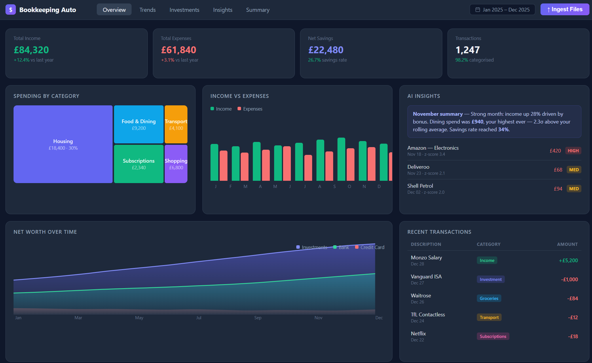

# Bookkeeping Auto

Automatic bookkeeping and personal finance dashboard — sync holdings and
transactions straight from broker APIs, ingest bank and credit-card statements,
let Claude categorise everything, then explore it all in a React dashboard.



## Summary

Connect a Trading 212 account and it pulls your positions, cash, transactions
and dividends on demand. Drop CSV or PDF statements into a folder for anything
without an API, and Claude detects the columns, parses the transactions and
assigns categories. Results appear in a web dashboard with five tiers of
analysis: from basic spending breakdowns through to AI-generated summaries,
cash flow projections and what-if planning.

Runs as a single local web app. No Docker, no cloud, no account — your data
stays in a SQLite file on your machine.

## Agents in Claude Duet

Yili's finance channel in Claude Duet runs this repository's code on a
schedule. Agents turn statements from mail or Drive into rows with
`backend/agent_tools/statement_to_ledger.py` and save them through the
[yili-mcp-connector](https://github.com/yi-li-yang/yili-mcp-connector)
connector, which also serves Trading 212, Monzo and pension values. The data
never comes back into this repository. See [AGENTS.md](AGENTS.md) for the
rules and [agents/routines.md](agents/routines.md) for what each routine does.

## Requirements

- Python 3.11 or newer
- Node 20 or newer
- An [Anthropic API key](https://console.anthropic.com/) for categorisation

## Getting started

```bash
git clone https://github.com/yi-li-yang/Bookkeeping-auto.git
cd Bookkeeping-auto

python -m venv .venv          # the scripts look for .venv/ at the repo root
cp .env.example .env          # then add your ANTHROPIC_API_KEY

npm install
npm run setup                 # installs backend + frontend dependencies
npm run start                 # builds the UI and serves everything on :8000
```

Open <http://localhost:8000>. API docs are at
<http://localhost:8000/docs>.

### Everyday commands

| Command | What it does |
|---|---|
| `npm run start` | Build the UI, then serve UI + API on `:8000`. One process, one URL. |
| `npm run dev` | `uvicorn --reload` on `:8000` **and** Vite on `:5173`, both hot-reloading. Use <http://localhost:5173>. |
| `npm run serve` | Serve without rebuilding the frontend. |
| `npm test` | Run the backend test suite. |

## Getting your data in

### Trading 212 (automatic)

Create an API key per account in the Trading 212 app under **Settings → API**.
Tick at least *Account data*, *Portfolio*, *History – Transactions* and
*History – Dividends*. If you restrict by IP, use your **public** IP — the one
`ipconfig`/`ifconfig` shows is your private LAN address and will not work.

Add to `.env` — Trading 212 issues one key pair per account, so an Invest
account and a Stocks ISA need separate keys:

```bash
T212_API_KEY_INVEST=your-api-key-id
T212_API_SECRET_INVEST=your-secret-key
T212_API_KEY_STOCKS_ISA=your-api-key-id
T212_API_SECRET_STOCKS_ISA=your-secret-key
T212_ENV=live                 # or demo; keys only work in the one they were made in
```

Then sync:

```bash
curl -X POST http://localhost:8000/api/investments/sync
```

This writes a dated snapshot of your holdings (including cash, so the total
reconciles exactly with what Trading 212 reports), plus deposits, withdrawals,
fees, interest and dividends. Re-running is safe — records are matched on a
stable id, so nothing duplicates.

Trading 212 does not tell you which account a key belongs to, so the sync works
it out by matching your live positions against previous snapshots, and warns if
that contradicts the variable name you stored it under.

### Monzo (automatic)

Register a **confidential** OAuth client at <https://developers.monzo.com/>
with redirect URL `http://localhost:8000/api/banks/monzo/callback`, then add to
`.env`:

```bash
MONZO_CLIENT_ID=oauth2client_...
MONZO_CLIENT_SECRET=mnzconf...
```

Visit <http://localhost:8000/api/banks/monzo/connect>, approve the request in
the Monzo app when the push notification arrives, then sync:

```bash
curl -X POST http://localhost:8000/api/banks/monzo/sync
```

**Sync promptly after linking.** Monzo serves the complete transaction history
only for about five minutes after authorisation; after that only the last 90
days are reachable, and reconnecting does not reopen the window. The first sync
pulls everything automatically, so the only thing that matters is running it
soon after you connect. Re-running is safe -- records are matched on a stable
id, so nothing duplicates.

Pot transfers and top-ups are filed as `Transfers` rather than spending, and
declined payments are skipped.

### Statements (manual)

Copy CSV or PDF statements into `data/input/` — that is the whole workflow.
The app watches that folder and ingests anything new within about 20 seconds,
so there is nothing to click. A file is only read once it has stopped changing,
so dropping in a part-downloaded PDF is safe.

To ingest on demand instead, set `AUTO_INGEST=false` and use the **Ingest
Files** button, or:

```bash
curl -X POST http://localhost:8000/api/ingest
```

Files are processed once; re-running skips anything already done. Investment
statement PDFs are recognised and parsed into holdings rather than transactions.

## Dashboard tiers

### Tier 1 — Overview (the "what happened" layer)

- **Spending breakdown** — treemap by category across the selected date range
- **Income vs Expenses** — monthly bar chart with savings rate line
- **Cash flow waterfall** — starting balance → income → expenses → ending balance
- **Transaction table** — searchable, filterable, with inline-editable categories and confidence flags

### Tier 2 — Trends (the "what's changing" layer)

- **Category spend trends** — line chart per category over time; anomaly spikes (1.5σ above rolling average) highlighted in red
- **Recurring expense detection** — surfaces subscriptions and regular charges with monthly/annual cost and trend direction
- **Spending velocity** — cumulative daily spend within a month against the prior month, showing when money flows out

### Tier 3 — Investments (the "where am I" layer)

- **Holdings** — every position with quantity, cost, value and unrealised return
- **Performance** — return by instrument
- **Allocation** — portfolio weight per position and per account
- **Portfolio history** — total value over time as snapshots accumulate
- **Dividends** — payment history with a per-month rollup
- **Net worth** — running balance by account type (bank, investment, credit card)

### Tier 4 — Insights (the "so what" layer)

- **AI monthly summary** — Claude writes a plain-English summary of any month with key numbers and unusual patterns
- **Anomaly detection** — flags transactions with a z-score > 2 within their category
- **Cash flow projection** — projects income, expenses and balance 3/6/12 months forward
- **What-if scenarios** — sliders to adjust categories and see the effect on savings rate

### Tier 5 — Summary (the UX layer)

- **Annual review** — income, expenses, savings rate, best/worst months, top categories
- **Data quality** — categorisation coverage, average confidence, uncategorised and user-corrected counts
- **Month-over-month comparison** — pick two months, see the biggest changes side by side

## Tech stack

- **Backend**: Python 3.11+, FastAPI, SQLAlchemy, httpx, pdfplumber, pandas
- **Frontend**: React 18, TypeScript, Vite, Recharts, Axios
- **LLM**: Anthropic Claude (`claude-opus-4-6`) via the `anthropic` SDK
- **Database**: SQLite at `data/bookkeeping.db`
- **Deployment**: a single FastAPI process serving the API and the built SPA

## Project structure

```text
backend/
  config.py       — all env vars and paths, in one place
  main.py         — FastAPI app; mounts the built SPA after the routers
  api/            — route handlers (analytics, transactions, investments, cards, ingest)
  integrations/   — broker API clients and sync services
  ingestion/      — file scanner, CSV/PDF parsers, LLM processor
  db/             — SQLAlchemy models, session, additive migrations
  tests/          — pytest, HTTP mocked via httpx.MockTransport
frontend/src/
  components/     — dashboard widgets (one file per chart/view)
  api/client.ts   — typed API layer
scripts/py.mjs    — resolves the venv Python cross-platform
data/input/       — drop statement files here before ingesting
```

## Known limitations

- **Net worth and portfolio value are computed separately** and do not
  reconcile — one derives from cumulative transactions, the other from holdings
  valuations.
- **Only Monzo syncs automatically among the banks.** Post-Brexit the UK sits
  outside PSD2 and the free routes to UK open banking have closed: Enable
  Banking covers the EEA only, and GoCardless/Nordigen has shut new signups.
  Chase, Amex, Bank of Scotland and M&S Bank remain a manual statement drop.
- **Klarna cannot be synced at all.** BNPL is not a PSD2 payment account, so
  there is no balance to read. Its instalments do show up as payments on
  whichever card funds them.

## Privacy

`data/bookkeeping.db` and `.env` are gitignored and should stay that way — the
database holds real transaction descriptions and holdings. Never commit real
financial data or credentials.

## Licence

MIT — see [LICENSE](LICENSE).
